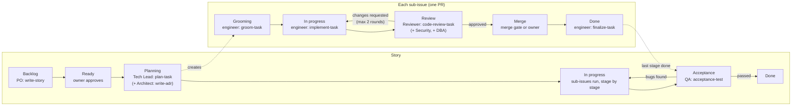

# The AI team

Pixora is built by a team of AI agents running in a self-hosted [Multica](https://multica.ai) workspace, with the repository owner approving what gets built and reviewing what merges. This folder is the team's source of truth: the skills each agent follows and (soon) each agent's instructions. They are reviewed and versioned like code, then loaded into Multica.

The method follows the _AI for Software Engineers Guide_ (Yehia Tech): plan the project in `docs/`, write rules (`CLAUDE.md`) and skills once, run every task through the same skills in the same order, and keep a person responsible for what merges.

## 1. The team

| Agent                     | Model / effort | Role                                                                                                                                                          |
| ------------------------- | -------------- | ------------------------------------------------------------------------------------------------------------------------------------------------------------- |
| Product Owner             | Opus, high     | Turns the owner's requests (Telegram or the board) into user stories with acceptance criteria. Never writes code or decides architecture.                     |
| Tech Lead                 | Sonnet, high   | Squad leader. Plans approved stories into PR-sized sub-issues, assigns them, moves the board.                                                                 |
| Architect                 | Opus, high     | Consulted by the Tech Lead when a plan needs a new decision. Writes ADRs.                                                                                     |
| Backend Engineer          | Sonnet, high   | Implements service, gateway and hub contract tasks.                                                                                                           |
| Frontend Engineer         | Sonnet, high   | Implements pixora-web tasks.                                                                                                                                  |
| DBA                       | Sonnet, high   | On demand: reviews every migration, helps design schemas.                                                                                                     |
| Security Engineer         | Opus, high     | On demand: reviews security-sensitive changes, keeps the threat models in `docs/security/`.                                                                   |
| Code Reviewer             | Opus, high     | Reviews every PR against its plan, the rules and the docs.                                                                                                    |
| QA Engineer               | Sonnet, high   | Checks every finished story on the running system against its acceptance criteria, owns the Playwright end-to-end tests, triages nightly end-to-end failures. |
| Senior Backend / Frontend | Opus, high     | Backup: takes over a single task after two failed review rounds.                                                                                              |

Effort is never below high. The CI merge gate is a GitHub Action, not an agent.

**Two runtimes, for separation of duties:** the Code Reviewer, the Security Engineer and the DBA run under their own Linux user (`multica-reviewer`), which holds the key of the `pixora-review` GitHub App: the only identity whose approval the merge gate accepts. Every other agent runs under `multica-agent` and can't approve anything ([ADR-0020](../docs/decisions/0020-merge-gate.md)).

## 2. How work moves

Two kinds of issues move on the board: the **story** (what the owner asked for) and its **sub-issues** (one per PR).

**A story:**

| Column      | Owner                   | Skill                                                                          | Leaves the column when                                                                   |
| ----------- | ----------------------- | ------------------------------------------------------------------------------ | ---------------------------------------------------------------------------------------- |
| Backlog     | Product Owner           | [write-story](skills/write-story/SKILL.md)                                     | The owner approves the story                                                             |
| Ready       | Tech Lead               |                                                                                | Planning starts                                                                          |
| Planning    | Tech Lead (+ Architect) | [plan-task](skills/plan-task/SKILL.md), [write-adr](skills/write-adr/SKILL.md) | Sub-issues exist; the owner approved the plan if it creates an ADR or changes a contract |
| In progress | Tech Lead               |                                                                                | Every sub-issue of every stage is Done                                                   |
| Acceptance  | QA Engineer             | [acceptance-test](skills/acceptance-test/SKILL.md)                             | Every acceptance criterion passed on the running system, or bugs were filed and fixed    |
| Done        |                         |                                                                                |                                                                                          |

**A sub-issue:**

| Column      | Owner                | Skill                                                | Leaves the column when                                                                              |
| ----------- | -------------------- | ---------------------------------------------------- | --------------------------------------------------------------------------------------------------- |
| Grooming    | Engineer             | [groom-task](skills/groom-task/SKILL.md)             | The task has steps with success criteria and fits in one PR (≤ 400 lines)                           |
| In progress | Engineer             | [implement-task](skills/implement-task/SKILL.md)     | The PR is open and CI is green                                                                      |
| Review      | Code Reviewer        | [code-review-task](skills/code-review-task/SKILL.md) | Approved through the `pixora-review` App (with Security and DBA where required), or sent back       |
| Merge       | Merge gate (+ owner) |                                                      | Auto-merge merges the PR once the `merge-gate` check is green ([merge gate](../docs/merge-gate.md)) |
| Done        | Engineer             | [finalize-task](skills/finalize-task/SKILL.md)       | Follow-ups recorded, docs and lessons handled                                                       |

**The owner's checkpoints:**

1. **Every story** is approved before planning (Backlog → Ready).
2. **A plan** is approved only when it creates an ADR or changes an API or event contract.
3. **Every PR the gate won't merge automatically** (migrations, security, dependencies, CI, large PRs, the agents' own rules, and every PR during the pilot): the owner goes through the guide's "own it" checklist posted on the PR and approves the `owner-approval` step with one tap; auto-merge does the rest.

**Review loop:** at most two rounds with the same engineer. A third round goes to the senior engineer for that side; if the senior's PR also fails two rounds, the task goes to the owner.

## 3. Skills

Each skill is a folder with a `SKILL.md`: a name, a description that says when to use it, and the steps. Multica writes the skills bound to an agent into `.claude/skills/` before each run.

**Workflow skills** (one per stage, as in the guide, plus the stages before and after):

| Skill                                                | Used by       | Does                                                                                    |
| ---------------------------------------------------- | ------------- | --------------------------------------------------------------------------------------- |
| [write-story](skills/write-story/SKILL.md)           | Product Owner | Turns a request into a user story with Given/When/Then acceptance criteria              |
| [write-adr](skills/write-adr/SKILL.md)               | Architect     | Records a decision a plan needs, with its alternatives                                  |
| [plan-task](skills/plan-task/SKILL.md)               | Tech Lead     | Reads the story and the docs, writes the plan, creates one sub-issue per PR             |
| [groom-task](skills/groom-task/SKILL.md)             | Engineers     | Splits a sub-issue into small steps, each with a success criterion; checks the size     |
| [implement-task](skills/implement-task/SKILL.md)     | Engineers     | Test-first, step by step; format, lint, tests; opens the PR; handles review rework      |
| [code-review-task](skills/code-review-task/SKILL.md) | Code Reviewer | Reviews the diff against the plan, the rules and the docs; approves or sends back       |
| [finalize-task](skills/finalize-task/SKILL.md)       | Engineers     | After the merge: checks `main`, records follow-ups, docs and lessons, closes the task   |
| [acceptance-test](skills/acceptance-test/SKILL.md)   | QA Engineer   | Checks the finished story on the running system, files bugs, keeps the end-to-end tests |

**Role skills** (knowledge, used alongside the workflow skills):

| Skill                                                | Used by                              |
| ---------------------------------------------------- | ------------------------------------ |
| [spring-backend](skills/spring-backend/SKILL.md)     | Backend engineers, Reviewer          |
| [angular-frontend](skills/angular-frontend/SKILL.md) | Frontend engineers, Reviewer         |
| [postgres-flyway](skills/postgres-flyway/SKILL.md)   | DBA, backend engineers, Reviewer     |
| [security-review](skills/security-review/SKILL.md)   | Security Engineer, Reviewer          |
| [contract-first](skills/contract-first/SKILL.md)     | Everyone who touches an API or event |

## 4. Where this differs from the guide, and why

- **The PR is opened by implement-task, not finalize-task.** CI and the review run on the PR, so it has to exist before review. finalize-task runs after the merge instead.
- **The merge is done by a deterministic merge gate, not by an agent.** Low-risk PRs merge automatically when every check passes and the `pixora-review` App approved; everything else waits for the owner's approval, given after the guide's "own it" checklist (posted on the PR by the gate). Details: [merge-gate.md](../docs/merge-gate.md).
- **Plans are approved by the owner only when they create an ADR or change a contract**, instead of every plan. Stories are always approved, so nothing gets built that the owner didn't ask for.
- **A QA stage after the last PR.** The guide reviews each change; Pixora also checks each finished story as a whole on the running system, because a story spans several PRs and repos.

## 5. Rules for every agent

- **Read before you write:** the repo's `CLAUDE.md`, then the hub docs it points to. The hub is checked out next to the repo you work in (`multica repo checkout https://github.com/JaouadiOussama/pixora`).
- **One task = one goal = one PR.** Anything else you notice becomes a new issue.
- **Stop and ask** instead of guessing: unclear acceptance criteria go to the Product Owner, design questions to the Tech Lead, anything that contradicts the docs to the Tech Lead (who involves the Architect).
- **Never** print, commit or paste a secret. Never weaken a check, a test or a rule to make CI pass.
- **The same mistake twice becomes a rule:** finalize-task proposes it for the repo's `CLAUDE.md` (in its own PR).

## 6. Board status keys

The columns are custom statuses in the Multica workspace. Their keys, used by the skills:

| Column              | Status key    |
| ------------------- | ------------- |
| Backlog             | `backlog`     |
| Ready               | `todo`        |
| Planning            | `planning`    |
| Grooming            | `grooming`    |
| In progress         | `in_progress` |
| Review              | `in_review`   |
| Merge               | `merging`     |
| Acceptance          | `acceptance`  |
| Done                | `done`        |
| Blocked (any stage) | `blocked`     |

`planning`, `grooming`, `merging` and `acceptance` are created when the board is set up; the others are Multica's built-in keys.
