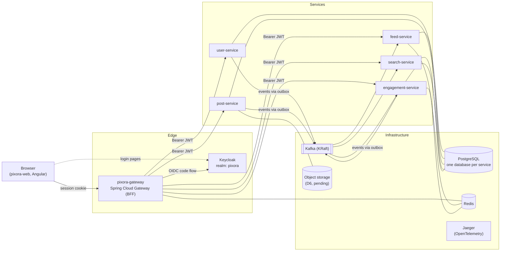

# Architecture

Status: **stage 1, in progress.** Sections marked *pending* depend on decisions that are still open (see [decisions](decisions/README.md)).

## 1. Overview

Pixora is a photo-sharing platform made of independent Spring Boot services behind one Spring Cloud Gateway. The Angular app talks only to the gateway. Services talk to each other mainly through Kafka events. A synchronous call is allowed only when a request truly needs an answer right away, and it must go through Resilience4j.

## 2. Components

| Component | Responsibility | Owns |
|---|---|---|
| **pixora-gateway** | The only public entry point. Acts as the BFF: OIDC login with Keycloak, server-side sessions, CSRF protection, `TokenRelay` to services. Routes `/api/**` to services and `/` to the Angular app (same origin). | Sessions (Redis) |
| **Keycloak** | Identity provider: sign-up, login, logout, forgot password, password storage, the Pixora login theme. Realm config is kept as code in this repo. | Users' credentials (its own database) |
| **user-service** | Profiles (created on the first authenticated request) and the follow graph. | `user` database |
| **post-service** | Photo posts (1–10 photos, caption, hashtags) and presigned upload URLs. | `post` database, object storage |
| **feed-service** | Builds and serves home feeds. Fan-out on write into Redis first; a pull path for very popular accounts comes later. | Feed timelines (Redis) |
| **engagement-service** | Likes and comments, and their counters. | `engagement` database, counters (Redis) |
| **search-service** | Username autocomplete and hashtag search, built from events. | Search index (engine: D6, pending) |
| **pixora-web** | Angular SPA. Holds **no tokens**. Calls the gateway with the session cookie. | — |

The service boundaries above are the starting point; the exact list of endpoints and events is set in `contracts/`.

## 3. Cross-cutting rules

- **One database per service**, all on one PostgreSQL server (the dev laptop has limited disk). A service never reads another service's database.
- **Async first.** State changes are published as Kafka events through a **transactional outbox**. See [events.md](events.md).
- **Sync calls** (service to service, REST) only when needed, always with Resilience4j (timeout, retry, circuit breaker), and they forward the user's JWT.
- **No service discovery or config server** (no Eureka, no Spring Cloud Config). Docker Compose service names and environment variables are enough.
- **No shared code library.** Services share **contracts** (OpenAPI, AsyncAPI) from this hub, never Java code.
- **Contract tests** check every service against the contracts in this hub.
- **Observability from day 1:** OpenTelemetry traces to Jaeger. Trace context is also passed in Kafka headers, so one trace follows a request through the events it causes.
- **Tests:** unit and integration tests on the backend and the frontend for every change.

## 4. Authentication

Keycloak, with the gateway acting as a **BFF**. Tokens never reach the browser. Full workflow: [authentication.md](authentication.md). Decision: [ADR-0006](decisions/0006-keycloak-with-gateway-bff.md).

## 5. Messaging and Redis

- **Kafka in KRaft mode** (no ZooKeeper). One broker in dev. Decision: [ADR-0007](decisions/0007-kafka-kraft-with-transactional-outbox.md).
- **Redis**, one server with a key prefix per owner. Redis is never the source of truth: everything in it can be rebuilt from PostgreSQL or Kafka. Decision: [ADR-0008](decisions/0008-redis.md).

| Owner | Use | Key prefix (proposed) |
|---|---|---|
| gateway | HTTP sessions (Spring Session) | `pixora:gateway:session:` |
| feed-service | Precomputed home timelines | `pixora:feed:` |
| engagement-service | Like and comment counters (cache; PostgreSQL is the truth) | `pixora:engagement:` |
| gateway (later) | Rate limiting | `pixora:gateway:ratelimit:` |

## 6. Technology versions

Java 25 LTS (virtual threads), Spring Boot 4.1.2 for the services, Spring Boot 4.0.9 + Spring Cloud 2025.1.4 for the gateway (until Spring Cloud 2026.0 is GA), Angular 22.2.4, Node 26 LTS. Infrastructure images are pinned to their latest stable versions when the Compose file is written. Decision: [ADR-0005](decisions/0005-technology-versions.md).

## 7. Local environment notes

- The dev laptop has ~23 GB RAM, 8 cores and **little free disk**, so keep images, Kafka retention and volumes small.
- Ports **3000 and 8080 are already used** (Multica) on the dev laptop. Pixora's ports are set when the Compose file is written.

## 8. Pending

- **D6:** object storage (MinIO) and the search engine (PostgreSQL full-text vs Elasticsearch/OpenSearch).
- **D8:** deploy now or later.
- Gateway flavour (reactive WebFlux vs Web MVC with virtual threads): to settle when the gateway is set up.
