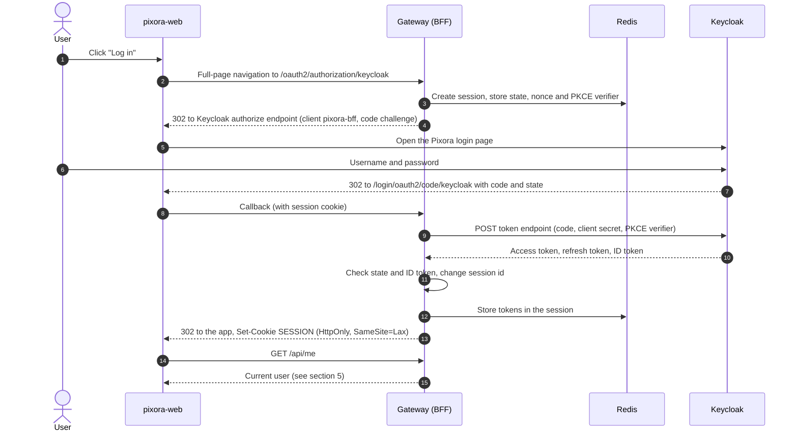
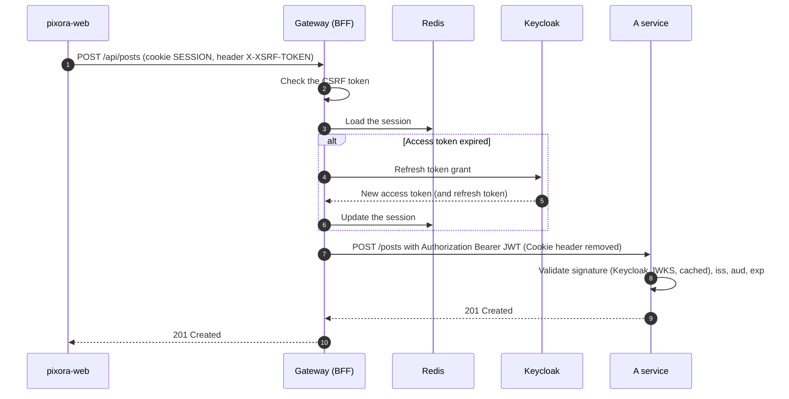
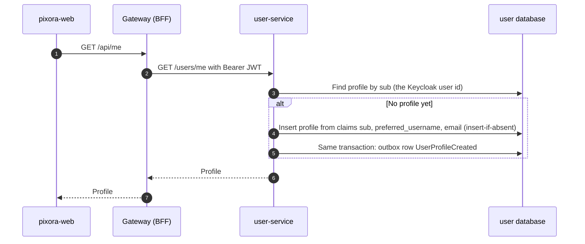
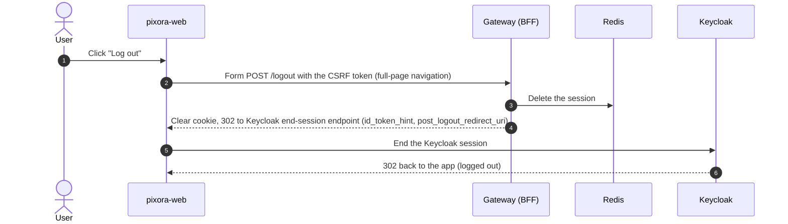

# Authentication workflow

Decision: [ADR-0006: Keycloak with the gateway as a BFF](decisions/0006-keycloak-with-gateway-bff.md).

## 1. The idea in one paragraph

**BFF = Backend For Frontend.** The gateway logs the user in with Keycloak on the browser's behalf, using the OIDC authorization code flow as a *confidential client* (it has a client secret). It keeps the access and refresh tokens **in a server-side session in Redis** and gives the browser only an **httpOnly session cookie**. On every API call it looks up the session and forwards the request to the service with `Authorization: Bearer <access token>` (`TokenRelay`). The Angular app never sees a token, so an XSS bug can't steal one.

```
Browser ──(cookie SESSION=abc)──► Gateway ──(Bearer <JWT>)──► services
                                     │
                           Redis: abc → {access, refresh, id tokens}
```

## 2. Actors

| Actor | Role |
|---|---|
| **pixora-web** (Angular) | Shows the UI. Holds no tokens. Sends the session cookie automatically and the CSRF header on writes. |
| **pixora-gateway** | OAuth2 client (`oauth2Login`), session owner, CSRF check, `TokenRelay`. |
| **Keycloak** (realm `pixora`) | Login, sign-up, logout and forgot-password pages; issues tokens. |
| **Services** | OAuth2 resource servers. They validate the JWT and keep no session. |
| **Redis** | Gateway sessions (Spring Session). |
| **Mailpit** (dev only) | Catches Keycloak's emails (forgot password). |

## 3. Login



Notes:
- Login is a **full-page navigation**, not an `HttpClient` call: the browser must follow the redirects to Keycloak and back.
- The session id changes after login, which blocks session fixation.
- PKCE is used even though the gateway is a confidential client (defence in depth, as OAuth 2.1 recommends).

## 4. Calling the API



Rules:
- For `/api/**`, an unauthenticated request gets **401**, never a redirect. Angular reacts to 401 by starting the login (section 3).
- If the refresh fails (the Keycloak session ended), the gateway clears the session and answers 401.
- The gateway **removes the `Cookie` header** before routing to a service. Services only ever see the JWT.
- When a service calls another service synchronously during a request, it forwards the same JWT.

## 5. Current user and first-time profile creation

`/api/me` is routed to user-service (`GET /users/me`). This is also how a profile gets created: there is no separate "create profile" step after sign-up.



- The insert is **idempotent** (insert-if-absent on `sub`), so two parallel first requests can't create two profiles.
- The `sub` claim is the user's id everywhere in Pixora.

## 6. Sign-up

1. On the Keycloak login page the user clicks **Register** (user registration is enabled in the realm).
2. Keycloak shows the Pixora-themed registration form and creates the account.
3. Keycloak signs the user in and redirects back to the gateway callback. From here it is the same as login, steps 7–15.
4. The first `/api/me` creates the profile (section 5).

## 7. Forgot password

1. On the login page the user clicks **Forgot password?** (enabled in the realm).
2. Keycloak emails a reset link. In dev the email goes to **Mailpit**.
3. The user sets a new password on a Keycloak page and is signed in, as in login.

## 8. Logout



This is **RP-initiated logout**: the user is logged out of both Pixora and Keycloak, so the next login really asks for a password.

## 9. Security settings

| Item | Setting |
|---|---|
| Session cookie | `SESSION`, `HttpOnly`, `Secure` (outside localhost), `SameSite=Lax`, `Path=/` |
| Session store | Redis via Spring Session; idle timeout matches Keycloak's SSO idle timeout |
| CSRF | Required on POST, PUT, PATCH and DELETE. The gateway sets a JS-readable `XSRF-TOKEN` cookie; Angular's `HttpClient` sends it back as `X-XSRF-TOKEN` automatically (same origin only) |
| CORS | Not needed: the app and the API share one origin through the gateway |
| Tokens | Never sent to the browser. Access tokens are short-lived (Keycloak default, 5 minutes) |
| Services | Stateless resource servers. They check signature, `iss`, `aud` = `pixora-api` and `exp` |
| Keycloak client `pixora-bff` | Confidential, authorization code flow only, PKCE required, exact redirect URIs, no implicit or password grants |
| Audience | An audience mapper adds `pixora-api` to access tokens |
| Roles | Realm role `user` by default; `admin` later |

## 10. Realm as code

The `pixora` realm (clients, roles, mappers, registration and forgot-password settings, SMTP to Mailpit, login theme) is exported to a JSON file in this repo and imported automatically when Keycloak starts (`--import-realm`). Any realm change goes through a pull request like code. Secrets are not stored in the export; they come from environment variables.

## 11. Later

- Login with Google (Keycloak identity provider).
- Two-factor authentication (OTP) in Keycloak.
- A mobile app would get its own public Keycloak client using PKCE, because cookies don't fit native apps.
