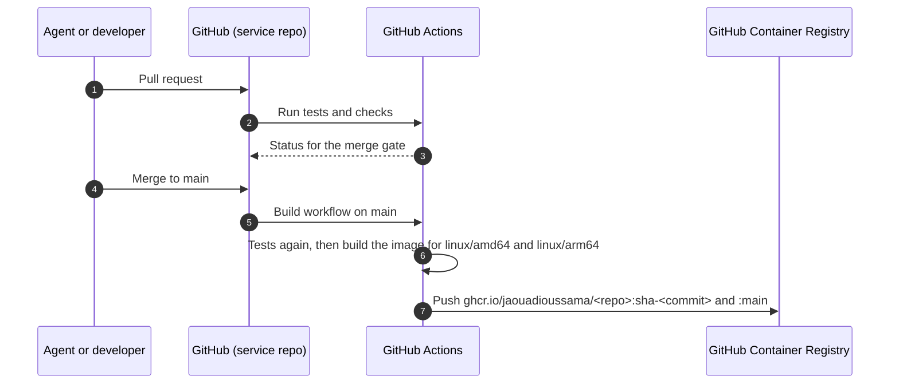

# Build, release and deployment

Decision: [ADR-0011: Deploy later, build deployable images from the start](decisions/0011-deploy-later-build-deployable-now.md).

## 1. Status

**Not deployed.** Pixora runs locally with Docker Compose. Deployment happens at the **feed milestone** (authentication, profiles, photo posts and the home feed working end to end), after a new ADR picks the host.

## 2. Image workflow (from stage 2)

- **Every repo** (the 6 services, the gateway and the web app) publishes an image the same way, through a reusable workflow kept in this hub.
- **Tags:** `sha-<short commit>` (never changes) and `main` (latest). Version tags (`v1.2.0`) are added when releases start.
- **Images:** a slim JRE 25 base for the Java services, an nginx base for the Angular build. Both are multi-arch. They run as a non-root user.
- **No configuration in images.** Everything (URLs, credentials, Keycloak issuer, storage endpoint, Kafka servers) comes from environment variables, so the same image runs in dev, CI and production.

## 3. Compose files in this hub

| File | Purpose |
|---|---|
| Dev Compose file | Builds or pulls everything for local work: services, Keycloak (dev mode), Kafka, Redis, PostgreSQL, SeaweedFS, Elasticsearch, Jaeger, Mailpit |
| Production Compose file | Pulls images by `sha-` tag only, Keycloak in production mode, security on everywhere, no Mailpit, secrets from an environment file that is never committed |

## 4. Go-live checklist (at the feed milestone)

Pixora is not shared publicly until every item is done.

**Security**
- [ ] HTTPS everywhere, with automatic certificates.
- [ ] Keycloak in production mode with a fixed hostname; brute-force detection on; admin console not reachable from the internet.
- [ ] Elasticsearch, Kafka, Redis, PostgreSQL and object storage reachable only on the internal network, with authentication on.
- [ ] Secrets only in the server's environment file, never in Git. All dev passwords replaced.
- [ ] Rate limiting on the gateway (login, sign-up, uploads).
- [ ] Sign-up is limited for the demo (invite or approval), because a public photo app attracts abusive content.

**Operations**
- [ ] Daily PostgreSQL backups, stored off the server, with one restore tested.
- [ ] Disk alerts (Kafka, Elasticsearch and photos all grow).
- [ ] A budget alert on the cloud account.
- [ ] Updates: a documented way to move to a new `sha-` tag and to roll back.

**Product**
- [ ] A short privacy page (what is stored, how to delete an account).
- [ ] Demo accounts with sample posts.

## 5. Decided later (feed-milestone ADR)

- Host: Oracle Cloud Always Free (ARM) if it is still viable, otherwise Hetzner Cloud (ARM).
- Domain and HTTPS (for example Caddy).
- Production object store: SeaweedFS on the server or Cloudflare R2 (no egress fees); a CDN for `/media/**`.
- Docker Compose or k3s.
