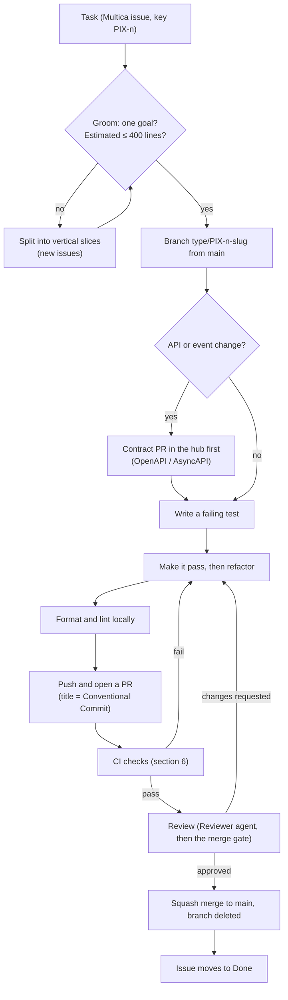

# Engineering guidelines

How work moves from a task to `main` in every Pixora repository: branches, commits, pull requests, tests, code quality and the checks CI runs. These rules apply the same way to people and to AI agents.

Decisions: [ADR-0012](decisions/0012-trunk-based-development-with-small-squash-merged-prs.md) (branches, commits, PRs), [ADR-0013](decisions/0013-test-strategy-and-quality-gate.md) (tests and quality gate), [ADR-0014](decisions/0014-code-style-formatting-and-null-safety.md) (code style and static analysis). Code layout and API rules are in [conventions.md](conventions.md).

## 1. From task to merge



The review loop and the agents' roles are in [agents/README.md](../agents/README.md). Which PRs merge automatically and which need the owner is decided by the [merge gate](merge-gate.md) ([ADR-0020](decisions/0020-merge-gate.md)).

## 2. Branches and commits

- **Trunk-based development.** `main` is the only long-lived branch. It is protected: no direct pushes, no force pushes, linear history only, and a branch must be up to date with `main` before it merges.
- **One short-lived branch per task**, created from `main`, named `<type>/<issue-key>-<short-slug>`:
  - `feat/PIX-12-signup-page`
  - `fix/PIX-31-feed-duplicate-posts`
  - The issue key is the Multica issue key (`PIX-12` here is an example; the prefix is the one the Multica workspace uses).
  - The branch is deleted after the merge.
- **Squash merge only.** One task = one PR = one commit on `main`. Work-in-progress commits on the branch are fine; they disappear in the squash.
- **The PR title becomes the commit message**, so it must follow [Conventional Commits](https://www.conventionalcommits.org/):

  ```
  <type>(<scope>): <summary in the imperative> (<issue-key>)

  feat(auth): add the sign-up page (PIX-12)
  fix(feed): skip posts already in the timeline (PIX-31)
  ```

  | Type | Use for |
  |---|---|
  | `feat` | A new behaviour for users or API clients |
  | `fix` | A bug fix |
  | `refactor` | A code change with no change in behaviour |
  | `test` | Tests only |
  | `docs` | Documentation only |
  | `build` | Build files, dependencies, Docker images |
  | `ci` | CI workflows |
  | `chore` | Anything else that changes no behaviour (config, tooling) |

  The scope is the feature or area (`auth`, `profile`, `feed`, `outbox`, `contracts`...). A breaking API or event change adds `!` after the scope (`feat(posts)!: ...`) and explains the break in the body.
- **Authorship:** commits are authored by the repository owner. Work done by an AI agent carries a `Co-authored-by: Claude <noreply@anthropic.com>` trailer.
- **No releases yet.** Images are tagged `sha-<commit>` and `main` ([deployment.md](deployment.md)). Conventional Commits keep the option to generate versions and changelogs automatically (release-please) when releases start.

## 3. Pull requests: one goal, small size

### One goal

- Every PR has **one goal**, stated in one sentence in the PR description, with a short **Out of scope** list.
- Never mix kinds of work. A feature, a refactor, a dependency bump and an unrelated fix are four PRs.
- Something worth fixing found along the way becomes a **new issue**, not an extra change in the current PR.
- The reviewer rejects a PR that does more than its stated goal.

### Size limits

Size = lines added + lines deleted, **tests included**. Generated code (for example `src/app/api/` in pixora-web), lockfiles, snapshots and binary files are not counted. CI measures it on every PR.

| Size | What happens |
|---|---|
| **≤ 400 lines** | Normal. Can merge automatically if every other gate passes. |
| **401–800 lines** | CI adds the `size/L` label. Never merges automatically; it needs the owner's approval ([merge gate](merge-gate.md)). |
| **> 800 lines** | CI fails. The PR must be split. In rare justified cases (a project scaffold, a mass rename) the owner temporarily switches off the size check in the ruleset ([ADR-0020](decisions/0020-merge-gate.md)). |

Why: review quality drops quickly as diffs grow. Google's engineering practices treat ~100 lines as a reasonable change and ~1,000 as usually too large, and the SmartBear/Cisco code review study found reviews lose effectiveness beyond 200–400 lines.

### Splitting happens before coding

- Grooming estimates the size of each task. A task expected to go over 400 lines is split into **vertical slices** that each work and are tested on their own. Example for sign-up: (1) the Keycloak realm config, (2) the gateway login flow, (3) `/api/v1/me` with first-time profile creation, (4) the Angular sign-up page.
- **No stacked PRs.** A task that depends on another one starts after that one is merged.
- An API change is two PRs: the contract in the hub first, then the implementation ([conventions.md](conventions.md#4-api-conventions)).

### PR description

Every repo has a PR template with:

1. **Goal**: one sentence.
2. **Issue**: the Multica issue key.
3. **Out of scope**: what this PR deliberately does not do.
4. **How it was tested**: the tests added or changed, and anything checked by hand.
5. **Notes for the reviewer**: risks, trade-offs, follow-up issues created.

## 4. Testing

### The test pyramid

**Backend (each Spring Boot service)**

| Layer | What it tests | Tools | Maven phase |
|---|---|---|---|
| **Unit** (most tests) | Domain logic and services, without Spring | JUnit Jupiter (as managed by Spring Boot), AssertJ, Mockito | `test` (Surefire), classes named `*Test` |
| **Slice** | One layer with a minimal Spring context: web layer, repositories | `@WebMvcTest` + MockMvc, `@DataJpaTest` | `test`, `*Test` |
| **Integration** | The service with real infrastructure: PostgreSQL, Kafka, Redis, Elasticsearch, Keycloak, SeaweedFS | `@SpringBootTest` + Testcontainers + `@ServiceConnection` | `verify` (Failsafe), classes named `*IT` |
| **Contract** | HTTP responses match the hub's OpenAPI spec; published and consumed events match the AsyncAPI schemas | An OpenAPI / JSON Schema validator in tests | `verify`, `*IT` |
| **Architecture** | Layout and dependency rules ([conventions.md](conventions.md#2-java-code-layout)) | ArchUnit | `test`, `*Test` |

- **Real engines only.** Integration tests never use H2 or other in-memory stand-ins; they hide bugs that only appear on the real database or broker.
- Testcontainers containers are started **once per test JVM** and shared by the test classes (singleton container pattern), so the suite stays fast.
- Async behaviour (Kafka consumers, the outbox relay) is tested with **Awaitility**, never with `Thread.sleep`.
- Each test creates the data it needs. No test depends on another test's data or on the order tests run in.

**Frontend (pixora-web)**

- Unit and component tests with **Vitest** (the Angular CLI default) and **Angular Testing Library**: tests interact with the page the way a user does (roles, labels, text), not with component internals.
- HTTP is tested with Angular's `HttpTestingController`.
- The API client is **generated from the hub's OpenAPI spec**, so a contract change the frontend has not followed breaks the build.

**End-to-end (hub, `e2e/`)**

- **Playwright** against the full system started with Docker Compose.
- Only the **critical user journeys**: sign up, log in, post a photo, see it in a follower's feed, like, comment, search. Everything else is covered lower in the pyramid.
- Runs on every hub PR and **nightly** against `main` of every repo. A nightly failure opens an issue automatically. From the deployment milestone it is also a gate before deploying.

### How tests are written

- **Test-first** (red, green, refactor): write a failing test, make it pass with the simplest code, then clean up. This is part of the implement-task workflow for agents.
- **A bug fix starts with a test that reproduces the bug.** The test fails before the fix and passes after it.
- Test names describe the behaviour ([conventions.md](conventions.md#test-names)).
- **A flaky test is a bug.** Open an issue and fix it or remove it; CI never retries tests to hide flakiness.

### Quality gate

Every PR must pass the **SonarQube Cloud** quality gate (free for public repos), using the **Sonar way** rules on **new code**:

| Condition | Threshold |
|---|---|
| Coverage of new code | **≥ 80%** (JaCoCo for Java, Vitest coverage for Angular) |
| Duplicated lines in new code | ≤ 3% |
| New issues (bugs, vulnerabilities, code smells) | 0 |
| Security hotspots in new code | 100% reviewed |

The gate is on new code, so nothing new merges untested, and old code never blocks a PR.

### Not gates (for now)

- **Mutation testing** (PIT): too slow for every PR. May run as a monthly report later.
- **Load and performance tests:** planned for the deployment milestone.

## 5. Code style and static analysis

Formatting is done by tools and is **never discussed in review**.

**Java**

- **Google Java Style**, applied by **google-java-format** through the **Spotless** Maven plugin. `mvn spotless:apply` formats; CI runs `mvn spotless:check` and fails on any unformatted file. IntelliJ users install the google-java-format plugin so the editor matches.
- **Null safety with JSpecify + NullAway**, the approach Spring Framework 7 itself uses. Every package has a `package-info.java` marked `@NullMarked`: nothing is null unless it is annotated `@Nullable`. NullAway runs at compile time inside **Error Prone**, so a possible `NullPointerException` fails the build.
- **Error Prone** also catches common bug patterns at compile time.
- No Checkstyle: the formatter enforces layout, and Error Prone and Sonar cover the rest.

**TypeScript / Angular**

- **Prettier** formats TypeScript, HTML, SCSS, JSON, YAML and Markdown.
- **ESLint** with **angular-eslint** and **typescript-eslint** (strict, type-checked rules) checks correctness. Prettier owns formatting; ESLint does not check style.
- TypeScript **`strict`** mode and Angular **strict templates** are on and stay on.

**All repositories**

- An `.editorconfig`: UTF-8, LF line endings, a final newline, trimmed trailing spaces.
- **CI is the gate, not git hooks.** Hooks slow every commit and can be skipped. Agents always run the formatter and linter before committing, and CI rejects anything that slips through.
- **Hub:** Prettier for Markdown and YAML; **Spectral** lints the OpenAPI and AsyncAPI files against the API conventions.

## 6. Checks on every pull request

| Check | Tool | Fails the PR when |
|---|---|---|
| PR title | Conventional Commits check | The title doesn't follow section 2 |
| PR size | Line count (section 3) | Over 800 lines (401–800 only adds `size/L`) |
| Formatting | Spotless, Prettier | A file isn't formatted |
| Compile-time analysis | Error Prone + NullAway, TypeScript strict | Any error |
| Lint | ESLint, Spectral (hub) | Any error |
| Tests | Unit, slice, integration, contract, ArchUnit (Maven `verify`), Vitest | Any failing test |
| Quality gate | SonarQube Cloud, Sonar way | Any condition in section 4 fails |
| Code scanning | CodeQL | A new alert of high or critical severity |
| New dependencies | GitHub dependency review | A newly added dependency has a known vulnerability |
| Container image | Trivy | A fixable vulnerability of high or critical severity |
| **Merge gate** (runs last) | `merge-gate` ([merge-gate.md](merge-gate.md)) | Required App reviews are missing, `main` is red, or the PR needs the owner and the owner hasn't approved yet |

Also on, outside the PR checks:

- **Secret scanning with push protection:** a push containing a credential is refused.
- **Dependabot:** version updates and security alerts. Each update is its own small PR and goes through the same checks.

These checks live in reusable workflows in this hub, so all eight repos run the same rules.

## 7. Definition of done

A task is done when:

- [ ] Its one goal is met, and nothing outside it changed.
- [ ] The contract was updated first in the hub, if the API or an event changed.
- [ ] Tests were written first and cover the change; a bug fix has a test that reproduces it.
- [ ] Every check in section 6 is green.
- [ ] The docs in this hub are updated if a workflow, rule or decision changed (a new decision gets an ADR).
- [ ] The review is approved and the PR is squash-merged to `main`.
