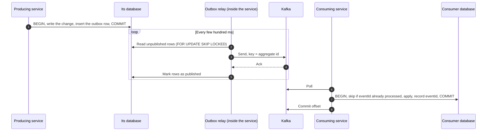

# Events and the transactional outbox

Decision: [ADR-0007: Kafka (KRaft) with a transactional outbox](decisions/0007-kafka-kraft-with-transactional-outbox.md).

## 1. Why an outbox

A service that changes its database **and** publishes to Kafka can't do both atomically. If it commits and then crashes before sending, the event is lost. If it sends and then the transaction rolls back, the event describes something that never happened.

The **transactional outbox** solves this. The service writes the event into an `outbox` table **in the same transaction** as the data change. A relay then reads the table and publishes to Kafka. An event exists if and only if the change was committed.

## 2. Flow



## 3. Guarantees and rules

- **At-least-once delivery.** An event can arrive twice (for example after a relay crash between send and mark). So:
- **Consumers are idempotent.** Each consumer keeps a `processed_event` table keyed by `eventId` and updates it in the same transaction as its own change.
- **Order per aggregate.** The Kafka key is the aggregate id (post id, user id...), so all events for one aggregate go to the same partition, in order. There is no global order.
- **Failures:** retries with backoff, then a dead-letter topic `<topic>.DLT`. A message in a DLT is a bug to investigate, not something to ignore.
- **Cleanup:** published outbox rows older than 7 days are deleted by a scheduled job.
- **Relay:** a polling publisher inside each service (`SKIP LOCKED` makes it safe with several instances). Change data capture with Debezium is not used for now: it needs Kafka Connect, which costs RAM and disk the dev laptop doesn't have.

## 4. Event format

JSON, described per topic in AsyncAPI (`contracts/asyncapi/`). Every event has the same envelope:

```json
{
  "eventId": "0b9f6c1e-6a7d-4c1f-9f5e-2f1d3c4b5a69",
  "eventType": "PostCreated",
  "eventVersion": 1,
  "occurredAt": "2026-10-30T09:15:00Z",
  "aggregateId": "8d2c...",
  "payload": { }
}
```

- `eventVersion` changes only for a breaking change; adding an optional field is not breaking.
- Trace context (`traceparent`) travels in **Kafka headers**, not in the body, so OpenTelemetry links the consumer's work to the original request.

## 5. Topics

- Name: `pixora.<service>.<aggregate>`, for example `pixora.post.post`.
- Dev: one broker (KRaft, no ZooKeeper), 3 partitions, replication factor 1, short retention to save disk.

## 6. Initial event catalog (proposal)

The final list is set in the AsyncAPI contracts, task by task.

| Event | Producer | Main consumers |
|---|---|---|
| `UserProfileCreated`, `UserProfileUpdated` | user-service | search-service |
| `UserFollowed`, `UserUnfollowed` | user-service | feed-service |
| `PostCreated`, `PostDeleted` | post-service | feed-service, search-service, engagement-service |
| `PostLiked`, `PostUnliked` | engagement-service | (counters; notifications in v2) |
| `CommentAdded`, `CommentDeleted` | engagement-service | (counters; notifications in v2) |
