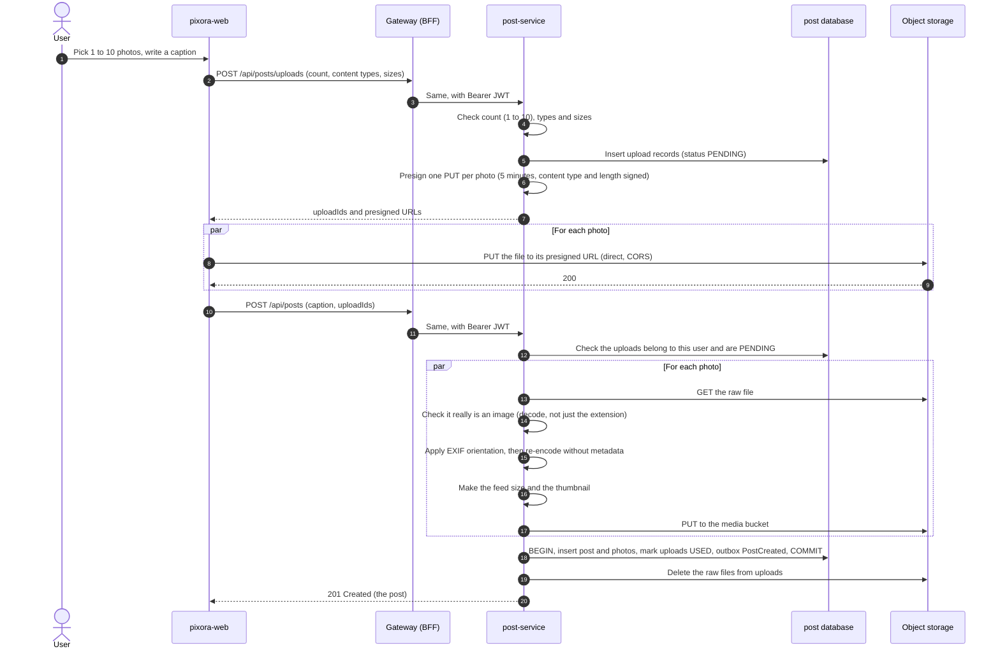
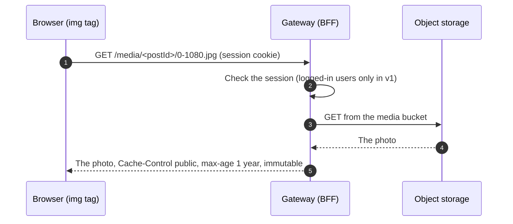

# Photo upload and serving workflow

Decision: [ADR-0009: S3 API for photo storage, SeaweedFS in dev](decisions/0009-s3-api-with-seaweedfs-in-dev.md).

## 1. The idea

Photos never pass through the gateway on the way in. post-service hands the browser **presigned PUT URLs**: short-lived links that allow uploading exactly one file to one place. The browser uploads straight to object storage. When the post is created, post-service checks each photo, removes its metadata, makes a smaller copy for the feed, and moves it to the `media` bucket.

## 2. Buckets

| Bucket | Content | Access |
|---|---|---|
| `uploads` | Raw files just uploaded by the browser, keyed `uploads/<uploadId>` | Private. Written only through presigned PUT URLs. CORS allows the app's origin, `PUT` only |
| `media` | Processed photos, keyed `media/<postId>/<index>-<size>.jpg` | Read through the gateway only (`/media/**`). Written only by post-service |

## 3. Upload and create a post

## 4. Rules

- **Accepted input:** JPEG, PNG and WebP, up to **10 MB** per photo, 1 to 10 photos per post. The check decodes the file; the extension and the declared type are not trusted.
- **Metadata removal:** photos are re-encoded, which drops EXIF, including **GPS location**. The EXIF orientation is applied first, so photos don't end up rotated.
- **Sizes produced:** a feed size (1080 px wide) and a thumbnail (320 px wide), as JPEG. The original upload is not kept.
- **Presigned URLs:** 5 minutes, one per file, with content type and length signed, so the browser can't upload something else or something bigger.
- **Ownership:** an `uploadId` can be used only by the user who requested it, and only once.
- **Processing runs in the create-post request**, on virtual threads, one photo per thread. If it gets too slow, it moves to an asynchronous step (post status `PROCESSING`) through a new ADR.

## 5. Cleanup

- A scheduled job in post-service deletes `PENDING` uploads older than 24 hours, and their files.
- If the database commit fails after the media files were written, those files have no post. The same job deletes `media/<postId>/` folders that have no post row.
- Lifecycle rules are not used: S3-compatible stores don't all support them the same way.

## 6. Serving photos

- **Same origin**, so no CORS for reading photos.
- Object keys are never reused (a new photo gets a new key), so the browser can cache photos forever.
- Object storage is never exposed directly to the internet. Only the gateway can reach it.
- In a deployment, a CDN can be put in front of `/media/**` (decided in D8).

## 7. Later

- Videos (v2) will need transcoding and probably asynchronous processing.
- WebP or AVIF output for smaller files.
