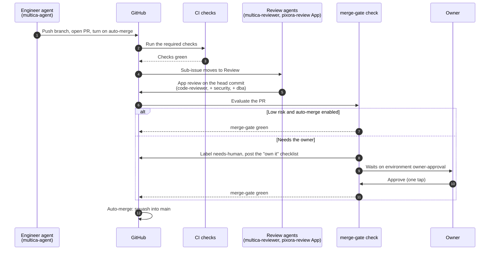

# Merge gate

How a pull request gets into `main` in every Pixora repository: who can approve it, which PRs merge automatically, and which wait for the owner.

Decision: [ADR-0020](decisions/0020-merge-gate.md). The review workflow itself (who reviews, how many rounds) is in [agents/README.md](../agents/README.md).

## 1. Why a gate

Every agent works through the owner's GitHub account, so its commits count as the owner's work. To GitHub, an agent _is_ the owner: it could add any label, write "approved" or press merge. Rules that rely on agents behaving would fail the first time an agent makes a mistake.

The gate applies **separation of duties**: whoever writes the code can't approve it, and **GitHub enforces the rules**. It has three layers.

| Layer                           | What it does                                                                                                                 | What it protects against                    |
| ------------------------------- | ---------------------------------------------------------------------------------------------------------------------------- | ------------------------------------------- |
| 1. Ruleset on `main`            | Nothing reaches `main` without a PR and green required checks, including the final `merge-gate` check. Nobody can bypass it. | Direct pushes, early merges, skipped checks |
| 2. `pixora-review` GitHub App   | The only identity whose approval counts. Review agents use it; coding agents can't.                                          | A coding agent approving its own work       |
| 3. `owner-approval` environment | Risky PRs wait for the owner's tap. Only the owner can give it.                                                              | Risky changes merging without the owner     |

## 2. Layer 1: the ruleset on `main`

- Pull request required; **squash merge only**; linear history; the branch must be up to date with `main`.
- Required status checks: every check in [engineering-guidelines.md](engineering-guidelines.md#6-checks-on-every-pull-request), plus **`merge-gate`**.
- **No bypass actors**, not even the owner. In an emergency the owner edits the ruleset in the repository settings; the change is visible in the audit log.
- **Agents' token:** a fine-grained personal access token limited to the Pixora repositories, with only _Contents_, _Pull requests_ and _Issues_ (read and write) and _Metadata_ (read). It can push branches and open PRs. It can't change settings, rulesets, secrets, environments or workflows' approvals.
- **Nobody presses "merge".** When implement-task opens a PR, it turns on **auto-merge** (`gh pr merge <pr> --auto --squash`). GitHub merges by itself as soon as every required check is green, and never before. The squash commit is credited to the PR author, so it counts on the owner's contribution graph.

## 3. Layer 2: approvals from the `pixora-review` App

- A **GitHub App** named `pixora-review` is installed on the Pixora repositories with _Pull requests: write_ and _Contents: read_. To GitHub it is a separate reviewer.
- The **Code Reviewer**, the **Security Engineer** and the **DBA** run on their own Multica runtime, under a separate Linux user (`multica-reviewer`) that holds the App's private key. The coding agents run under `multica-agent` and can't read it.
- They submit their verdict as a real GitHub review (Approve, Request changes or Comment) with the `pixora-review` command, which signs in as the App:

  ```bash
  pixora-review submit --repo pixora-user-service --pr 42 \
    --role code-reviewer --verdict approve --body-file review.md
  ```

  - `--role` is `code-reviewer`, `security` or `dba`. The command writes it as a marker on the first line of the review body, so the gate knows which role approved.
  - The review is attached to the PR's **current head commit**.

- **An approval only counts for the commit it was given on.** Any new push needs a new review.

## 4. Layer 3: the owner's approval

- For a PR that needs the owner, the gate:
  1. adds the label `needs-human` (for visibility only; labels decide nothing),
  2. posts the guide's **"own it" checklist** on the PR,
  3. starts a job that uses the GitHub **environment `owner-approval`**, whose only required reviewer is the owner.
- The owner reads the PR (on the phone or the laptop), goes through the checklist and **approves the deployment**. The `merge-gate` check turns green and auto-merge merges the PR.
- To reject, the owner leaves a review comment and rejects the deployment; the sub-issue goes back to the engineer.
- The agents' token has no permission to approve an environment, so only the owner can give this approval.

## 5. Which PRs merge automatically

The `merge-gate` check decides from the PR itself (title, size, files changed, author, reviews), never from a label an agent added.

| ✅ Merges automatically when ALL are true                         | 👤 Needs the owner if ANY is true                                                                                |
| ----------------------------------------------------------------- | ---------------------------------------------------------------------------------------------------------------- |
| All other required checks are green                               | More than 400 lines (`size/L`)                                                                                   |
| `pixora-review` approved the head commit as `code-reviewer`       | Breaking change (`!` in the title)                                                                               |
| Every extra role required below approved the head commit          | Type `ci` or `build`                                                                                             |
| 400 lines or fewer                                                | Changes the agents' rules: `CLAUDE.md`, `.claude/**`, hub `agents/**`                                            |
| Type `feat`, `fix`, `refactor`, `test`, `docs` or `chore`, no `!` | Changes `.github/**`, hub `docs/**`, hub `contracts/**`                                                          |
| No path from the right-hand column                                | Changes security code (see "Security paths" below)                                                               |
| `main` is green                                                   | Adds or changes a database migration ([ADR-0019](decisions/0019-flyway-database-migrations.md))                  |
| Auto-merge is enabled for the repository (off during the pilot)   | Changes dependency files (`pom.xml`, `package.json`, lockfiles), unless it is a Dependabot patch or minor update |
|                                                                   | Changes Dockerfiles or Compose files                                                                             |
|                                                                   | The review was escalated to the owner (2 rounds, then the senior, then the owner)                                |

**Extra roles the gate requires** (on top of `code-reviewer`):

| Role       | Required when the PR changes                                                                             |
| ---------- | -------------------------------------------------------------------------------------------------------- |
| `security` | Security paths, dependency files, upload and photo handling (post-service `media` and `upload` packages) |
| `dba`      | A database migration                                                                                     |

**Security paths** (initial list): anything in pixora-gateway's `security` package and its route configuration (`application*.yml`), any `security` package in a service, the Keycloak realm in the hub (`keycloak/**`).

**Dependabot:** patch and minor updates merge automatically once CI is green and the Code Reviewer approves. Major updates need the owner.

The path lists, the size limit and the pilot switch live in `.github/merge-gate.yml` in each repository. That file is under `.github/**`, so changing the gate's own rules always needs the owner.

## 6. Two more rules

- **A red `main` blocks merges.** While the latest CI run on `main` is failing, the gate blocks every PR except the one that fixes or reverts the failure (its title references the failing commit or the fix issue).
- **Pilot first.** Auto-merge is **off** for the first 5–10 PRs of each repository: every PR needs the owner. When the pilot results meet the thresholds in the team's step-up rules, the owner switches it on for that repository (`autoMerge: true` in `.github/merge-gate.yml`, a PR that itself needs the owner).

## 7. The whole flow



A new push at any point cancels the running gate and the approvals on the old commit; the PR goes through review again.

## 8. Limits

- **The gate protects against mistakes, not against a deliberately malicious agent.** `multica-agent` is in the `docker` group (Testcontainers needs it), which is equivalent to root on the laptop, so a deliberate attack could reach the App's key. Against the realistic risk, agent mistakes, the protection holds.
- **Checked during setup** before the gate is relied on: the agents' token can't approve the environment, merge early or edit the ruleset; auto-merge fires right after the owner's approval; the environment approval works from the GitHub mobile app (otherwise the GitHub website on the phone).
