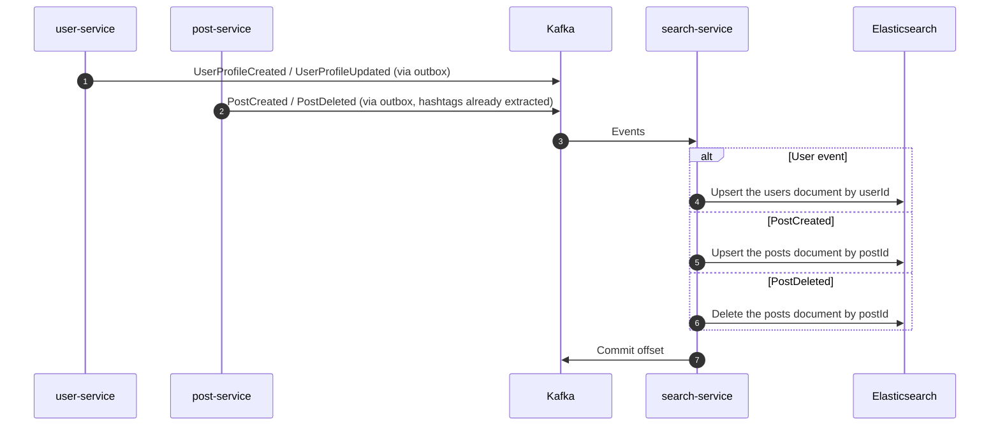

# Search workflow

Decision: [ADR-0010: Elasticsearch for search](decisions/0010-elasticsearch-for-search.md).

## 1. The idea

search-service is a **read model**. It doesn't own any business data: it listens to events from user-service and post-service and keeps Elasticsearch indexes that are shaped for searching. It has no database of its own.

## 2. Indexes

| Alias | One document per | Main fields | Used for |
|---|---|---|---|
| `users` | User | `userId`, `username` (`search_as_you_type`), `displayName`, `followerCount` | Username autocomplete |
| `posts` | Post | `postId`, `authorId`, `hashtags` (keyword), `createdAt` | Hashtag pages, hashtag counts |

Hashtag counts are not stored. They are computed with an aggregation on `posts`, so there is no counter to keep in sync.

## 3. Indexing

- **Idempotent by design:** every write is "set this document to this state" or "delete this document", so processing an event twice changes nothing. No `processed_event` table is needed.
- **Order:** events for one user or one post arrive in order (Kafka key = aggregate id), so a delete can't be overtaken by its create.
- **Hashtags** are extracted once, by post-service, and sent in `PostCreated`. search-service doesn't parse captions.
- **Follower counts** for ranking come later, from `UserFollowed` / `UserUnfollowed` (set as a value, not incremented).

## 4. Queries

| Endpoint (through the gateway, `/api/search/...`) | What it does |
|---|---|
| `GET /search/users?q=` | Username autocomplete: prefix match, small typo tolerance, ranked by match quality then follower count |
| `GET /search/hashtags?q=` | Hashtag autocomplete, with the number of posts for each |
| `GET /search/hashtags/{tag}/posts` | Post ids for a hashtag, newest first, paged. The app then loads the posts from post-service |

## 5. Rebuilding an index

Needed when a mapping changes or an index is lost.

1. Create a new index (for example `users-v2`) with the new mapping.
2. **Backfill** it from the source service through a paged internal export endpoint (user-service for users, post-service for posts). Replaying Kafka alone is not enough, because topic retention is short.
3. Keep consuming events into both indexes during the backfill.
4. **Swap the alias** `users` to `users-v2`, then delete the old index.

Searches keep working during the whole rebuild.

## 6. Dev setup

Single node, 512 MB heap, security off, reachable only on the Compose network. Security is on in any deployment.
